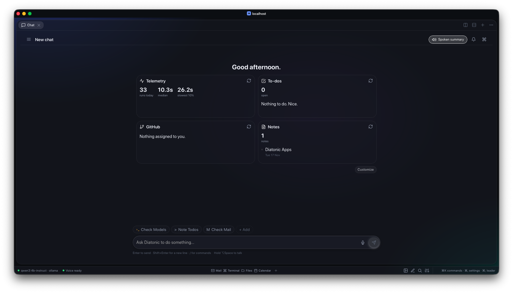
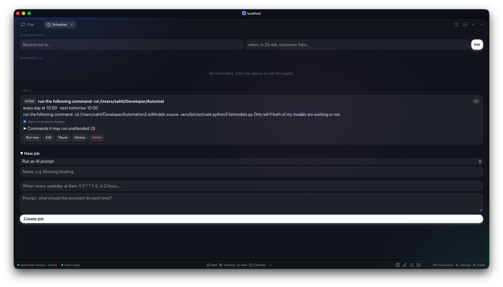

# Diatonic

**A local agent harness for your day-to-day apps.** Diatonic is everything around the model that turns it into a useful agent: the apps and tools, the agent loop, approvals, guardrails, memory and the interface. Plug in a small local model (or Gemini, or Groq) and it becomes an assistant for your mail, calendar, files, notes, to-dos, GitHub and terminal.


Everything runs locally at **http://localhost:5005**. The model is interchangeable; the harness is what makes even a 4B model reliable: it picks the few tools each request needs, checks and repairs tool arguments, cuts off loops, asks before anything that matters, and keeps private data away from cloud models. On top of that, the agent can change its own interface and build you new apps.

## What's inside

<table>
<tr>
<td width="50%"><br><b>Agent & live tiles</b>: ask the agent anything or use quick actions, with live snapshots for telemetry, to-dos, GitHub and notes.</td>
<td width="50%"><br><b>App launcher</b>: fast new-tab grid to launch any built-in app, app you built, or resume recent conversations.</td>
</tr>
<tr>
<td><br><b>Reminders & jobs</b>: plain-English reminders, scheduled prompt jobs with unattended permissions, and recurring script jobs.</td>
<td><br><b>Web search</b>: text-first web search and page reader that extracts clean content without browser overhead.</td>
</tr>
<tr>
<td><br><b>Command palette</b>: ⌘K palette for rapid keyboard navigation, app switching, panel splits, and shortcuts.</td>
<td><br><b>Custom layouts</b>: presets (single, split, stacked, grid) or save named layouts (Dev, Study, Work) to switch anytime.</td>
</tr>
<tr>
<td colspan="2"><br><b>Custom actions & prompts</b>: create saved prompts with placeholders like <code>{{input}}</code>, custom <code>/</code> slash commands, and script buttons.</td>
</tr>
<tr>
<td colspan="2">
<b>Also</b>

- **Calendar and Mail**: Google Calendar and Gmail across multiple accounts with sandboxed email reading
- **Files**: browse shared folders, code syntax highlighting, Markdown/PDF viewer, and safe diff-based editing
- A real **terminal** (tabs, vim, htop), and shell commands for the agent if you allow it
- **Apps the agent builds** from a sentence: trackers and lists, or apps on a web API
- **Local or cloud models** (Ollama, Gemini, Groq, and Google Antigravity `agy`), switchable from the status bar
- **Rule-based model routing**: route UI navigation to fast local models, and app creation or deep research to potent models
- **Non-destructive window zoom**: expand any panel to fill the screen while preserving your multi-panel layout tree
- **Voice**: push-to-talk dictation and short spoken summaries, all local
- **Parallel chats** that keep running in the background
</td>
</tr>
</table>

## Quick start

You need Python 3.11+ (3.12 for voice), [uv](https://docs.astral.sh/uv/) and [Ollama](https://ollama.com).

```bash
ollama pull qwen3:4b-instruct
uv venv --python 3.12 .venv
uv pip install -p .venv -e ".[voice]"      # drop [voice] if you don't want voice
./diatonic.sh                               # then open http://localhost:5005
```

Then connect what you use in **Settings**: Google accounts (Calendar and Mail), GitHub, shared folders in the Files panel, and cloud models if you want them. The [setup guide](docs/setup.md) walks through each one.

## Things you can say

| | |
|---|---|
| **Mail and calendar** | "summarise mails from the last 10 hours" · "when am I free tomorrow afternoon?" · "summarise this email" (with one open) |
| **Multi-app workflows** | "check my calendar for conflicts and draft email responses to Alex" · "read my meeting notes and add todos for each action item" |
| **Files and shell** | "@README.md fix the typo in the intro" · "what's taking the most space in ~/Developer?" · "git status of Diatonic" |
| **Deep research** | "deep dive into the worker pool memory leak" · "audit this repo for security regressions and explain the diff" |
| **Reminders and jobs** | "remind me to stretch at 6pm" · "every weekday at 8am, brief me on my calendar" · "move that reminder to 7pm" |
| **The screen & layout** | "open mail panel in split" · "zoom the calendar" · "unzoom" · "hide the sidebar" |
| **Building** | "create an app to track my exam studies: subjects, topics, done, notes" · "put my to-dos and mail on the home screen" |

## How it keeps you safe

- **You approve what matters.** Sending mail, editing or deleting files, running commands that aren't read-only, and running code the agent wrote all show an approval card with exactly what will happen: the diff, the full message, the command.
- **Antigravity runs sandboxed with command guardrails.** Antigravity (`agy`) runs in an isolated per-conversation folder (`--sandbox`) and connects back to Diatonic only through an authenticated local MCP server. Command guardrails automatically intercept and block unauthorized desktop app launchers (`open -a`, `osascript`, `ps`, `kill`) and direct `~/.diatonic` tampering. You can choose between **Strict** permissions or **Auto (like local models)** where safe reads and workspace file edits run automatically while destructive actions still ask for approval.
- **Email is treated as untrusted.** It's shown in a sandbox, it can't instruct the agent, and a run that read mail can't change the interface.
- **Cloud models ask before seeing private data.** With Gemini or Groq, Mail, Files, Notes and your other private apps need your OK first, and remembered facts and `@file` contents stay local.
- **Keys stay in the keychain.** They're never stored in the config, never sent to the page, and never put in a prompt.
- **Local only.** The server listens on `127.0.0.1` and refuses requests from other sites. Names you list in `server.allowed_hosts` (see [setup](docs/setup.md)) are the one way in for a proxy such as `tailscale serve`.

More in [How it works](docs/how-it-works.md#approvals).

## Keyboard

| Key | Action |
|---|---|
| ⌘K | Command palette |
| ⌘, | Settings |
| ⌘B | Show/hide the sidebar |
| ⌘⇧O | New chat |
| / | Focus the composer; typing it in the message box opens commands and saved prompts |
| Hold ⌥⇧Space | Push-to-talk |
| Enter / Shift+Enter | Send / new line |
| In the Terminal | ⌘C copies a selection, ⌘V pastes, ⌘K clears the terminal (not the palette), Esc goes to the program (it never denies an approval card) |

## Documentation

- [Setup](docs/setup.md): install, voice, Google and GitHub, running in the background, troubleshooting
- [The apps](docs/apps.md): Calendar, Mail, Files, reminders and jobs, to-dos, notes, home screen, terminal and shell, telemetry, memory
- [Making it yours](docs/customizing.md): the agent driving the interface, interface changes, apps the agent builds, models, quick actions
- [How it works](docs/how-it-works.md): approvals, parallel chats, guardrails for small models, adding an app, code layout, development
- [Roadmap](todo.md): what's next, and what still needs real-world testing

AWS Builder Code: T538H8

Python on [Starlette](https://www.starlette.io), with a plain HTML/CSS/JS frontend (no build step). The terminal uses [xterm.js](https://xtermjs.org) (MIT).
