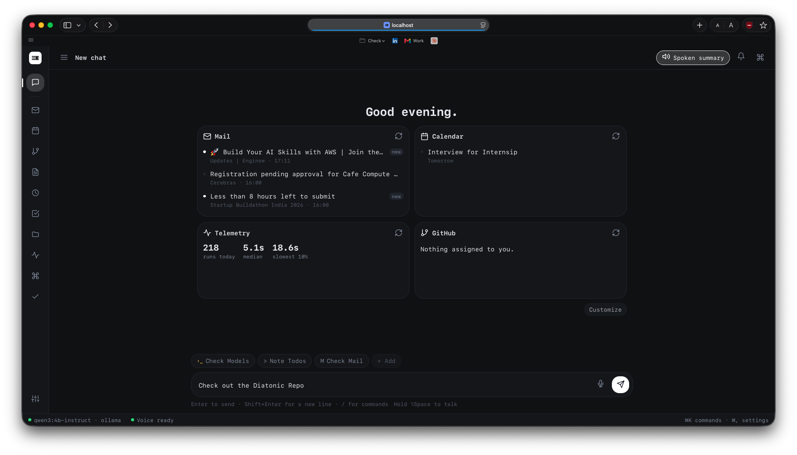
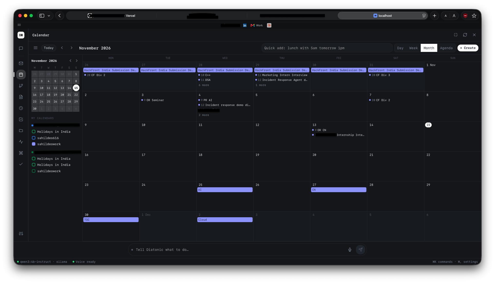
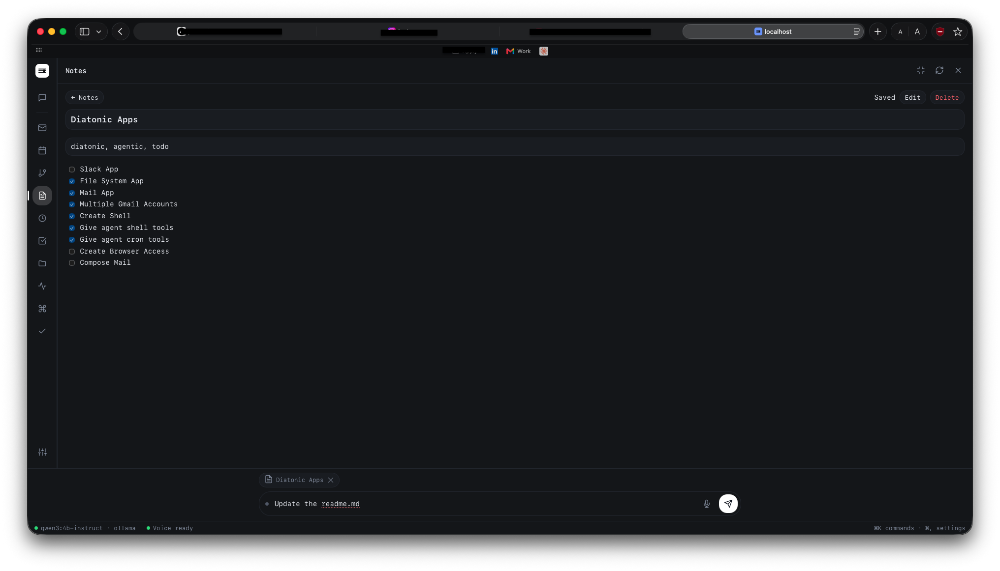
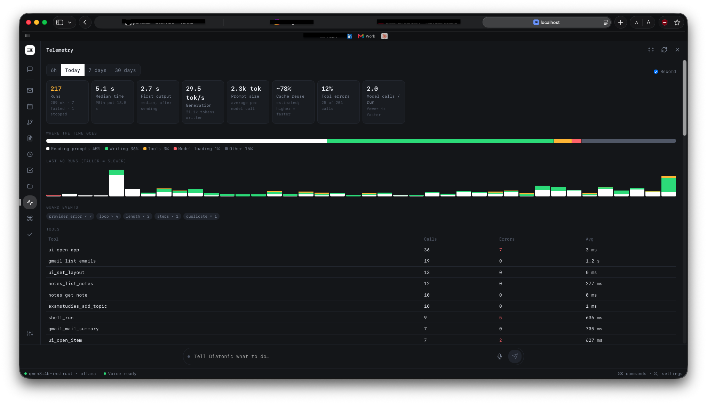
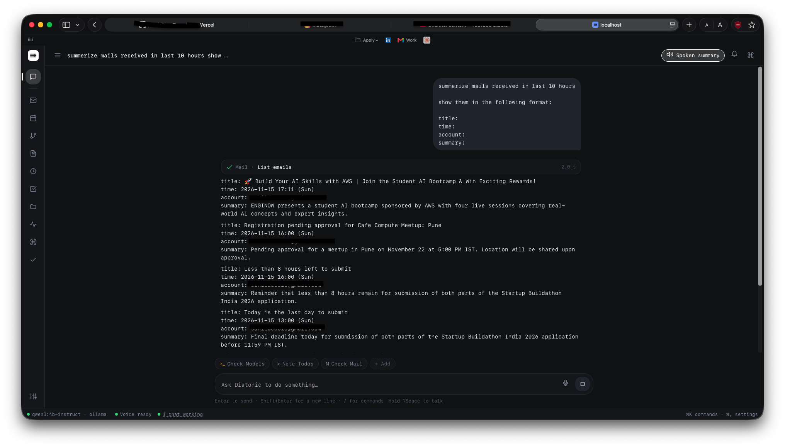
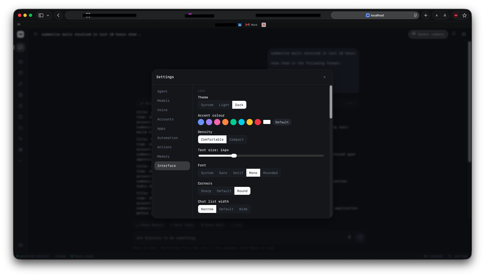

# Diatonic

**A local agent harness for your day-to-day apps.** Diatonic is everything around the model that turns it into a useful agent: the apps and tools, the agent loop, approvals, guardrails, memory and the interface. Plug in a small local model (or Gemini, or Groq) and it becomes an assistant for your mail, calendar, files, notes, to-dos, GitHub and terminal.



Everything runs locally at **http://localhost:5005**. The model is interchangeable; the harness is what makes even a 4B model reliable: it picks the few tools each request needs, checks and repairs tool arguments, cuts off loops, asks before anything that matters, and keeps private data away from cloud models. On top of that, the agent can change its own interface and build you new apps.

## What's inside

<table>
<tr>
<td width="50%"><br><b>Calendar and Mail</b>: any number of Google accounts, a Google-Calendar-style view and a Gmail-style inbox. Create events by hand or by asking.</td>
<td width="50%"><br><b>Files</b>: browse shared folders, view code, Markdown and PDFs, reference files in chat with <code>@</code>, and let the agent edit them (it shows you the diff first).</td>
</tr>
<tr>
<td><br><b>Notes, to-dos and reminders</b>: plain Markdown notes, to-dos with due dates, reminders and scheduled jobs that run a prompt or a script.</td>
<td><br><b>Telemetry</b>: how fast and reliable the agent is: time per run, where the time goes, cache reuse, tool errors.</td>
</tr>
<tr>
<td><br><b>Just ask</b>: "summarise the mails from the last 10 hours" reads both Gmail accounts and answers in the format you asked for.</td>
<td><br><b>Make it yours</b>: themes, layout and quick actions, or just ask the agent ("make the accent green", "add a button that opens my files").</td>
</tr>
<tr>
<td colspan="2">
<b>Also</b>

- A real **terminal** (tabs, vim, htop), and shell commands for the agent if you allow it
- **Apps the agent builds** from a sentence: trackers and lists, or apps on a web API
- **Local or cloud models** (Ollama, Gemini, Groq), switchable from the status bar
- **Voice**: push-to-talk dictation and short spoken summaries, all local
- **Home screen tiles** with live snapshots from your apps, in the layout you choose
- **Parallel chats** that keep running in the background
</td>
</tr>
</table>

## Quick start

You need Python 3.11+ (3.12 for voice), [uv](https://docs.astral.sh/uv/) and [Ollama](https://ollama.com).

```bash
ollama pull qwen3:4b-instruct
uv venv --python 3.12 .venv
uv pip install -p .venv -e ".[voice]"      # drop [voice] if you don't want voice
./diatonic.sh                               # then open http://localhost:5005
```

Then connect what you use in **Settings**: Google accounts (Calendar and Mail), GitHub, shared folders in the Files panel, and cloud models if you want them. The [setup guide](docs/setup.md) walks through each one.

## Things you can say

| | |
|---|---|
| **Mail and calendar** | "summarise mails from the last 10 hours" · "when am I free tomorrow afternoon?" · "summarise this email" (with one open) |
| **Files and shell** | "@README.md fix the typo in the intro" · "what's taking the most space in ~/Developer?" · "git status of Diatonic" |
| **Reminders and jobs** | "remind me to stretch at 6pm" · "every weekday at 8am, brief me on my calendar" · "move that reminder to 7pm" |
| **The screen** | "show my calendar for next week" · "open my latest email" · "hide the sidebar" |
| **Building** | "create an app to track my exam studies: subjects, topics, done, notes" · "put my to-dos and mail on the home screen" |

## How it keeps you safe

- **You approve what matters.** Sending mail, editing or deleting files, running commands that aren't read-only, and running code the agent wrote all show an approval card with exactly what will happen: the diff, the full message, the command.
- **Email is treated as untrusted.** It's shown in a sandbox, it can't instruct the agent, and a run that read mail can't change the interface.
- **Cloud models ask before seeing private data.** With Gemini or Groq, Mail, Files, Notes and your other private apps need your OK first, and remembered facts and `@file` contents stay local.
- **Keys stay in the keychain.** They're never stored in the config, never sent to the page, and never put in a prompt.
- **Local only.** The server listens on `127.0.0.1` and refuses requests from other sites.

More in [How it works](docs/how-it-works.md#approvals).

## Keyboard

| Key | Action |
|---|---|
| ⌘K | Command palette |
| ⌘, | Settings |
| ⌘B | Show/hide the sidebar |
| ⌘⇧O | New chat |
| / | Focus the composer; typing it in the message box opens commands and saved prompts |
| Hold ⌥⇧Space | Push-to-talk |
| Enter / Shift+Enter | Send / new line |
| In the Terminal | ⌘C copies a selection, ⌘V pastes, ⌘K clears the terminal (not the palette), Esc goes to the program (it never denies an approval card) |

## Documentation

- [Setup](docs/setup.md): install, voice, Google and GitHub, running in the background, troubleshooting
- [The apps](docs/apps.md): Calendar, Mail, Files, reminders and jobs, to-dos, notes, home screen, terminal and shell, telemetry, memory
- [Making it yours](docs/customizing.md): the agent driving the interface, interface changes, apps the agent builds, models, quick actions
- [How it works](docs/how-it-works.md): approvals, parallel chats, guardrails for small models, adding an app, code layout, development
- [Roadmap](todo.md): what's next, and what still needs real-world testing

Python on [Starlette](https://www.starlette.io), with a plain HTML/CSS/JS frontend (no build step). The terminal uses [xterm.js](https://xtermjs.org) (MIT).
