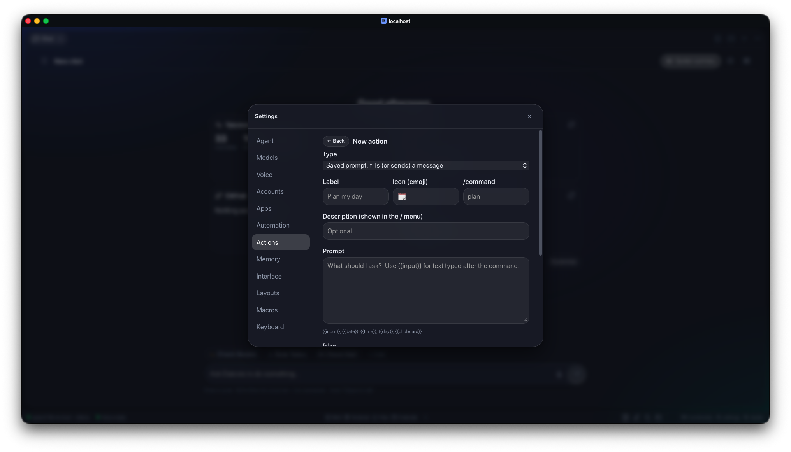

# Making it yours

The agent driving the interface, interface changes the agent makes, apps it builds, models, and your own buttons and commands. Back to the [README](../README.md).

## The agent can drive the screen

Ask it to "show my calendar", "show the month view", "open my latest email", "open the Diatonic Apps note", "open the interview event", "zoom the mail app", "restore layout" or "hide the sidebar" and it moves the window you asked from. These are the **Interface** tools (`ui_open_app`, `ui_open_item`, `ui_set_layout`): they only change what is displayed, read nothing and need no approval. Requests that begin with show/open/go to (and ask for no data, numbers or follow-up) are sent to the model with just these three tools, which keeps the prompt tiny and the choice obvious.

**The agent bar and zooming.** When an app fills the window (Calendar and Mail do by default) the chat column is hidden, so a bar at the bottom carries the conversation: type or use the mic, read the latest reply, and approve or deny actions without leaving the app. In split view the normal composer is the bar. Layout words the agent understands: *split* (chat and panel side by side), *zoom* (expand a panel to fill the window without closing other tabs), *unzoom* (restore all previous panels), *focus*, *chat* (no panel), and sidebar show/hide.

**"This" means what's open.** When an email, note or file is open, a chip above the message box shows it, and a request that says *this*, *it* or *that* ("summarize this email", "reply to it") tells the agent exactly which one. Click the chip to stop sharing it.

Only the window that started the run is moved.

### Ask the agent to change the interface

"Make the accent green", "bigger text", "make the sidebar 200 pixels wide", "add a button to the top bar that says Hello", "add a panel with a clock", "undo that". The agent picks the smallest tool that does it:

| Tool | For | Approval |
|---|---|---|
| `ui_set_theme` | accent, light/dark, density, font, text size, corners, chat width, chat-list width, which app icons show in the rail | no (undoable) |
| `ui_add_button` | a top-bar button that opens/closes an app, or asks the agent a prompt (data, not code) | no (undoable) |
| `ui_add_style` | custom CSS for one part of the page | no (undoable); CSS can't load anything from the network or touch the approval cards |
| `ui_add_script` | new behaviour, e.g. a button | **yes, the card shows the code** |
| `ui_create_file_app`, `ui_write_app_file` | a whole new app (a folder with `index.js`) with a rail icon | **yes, the card shows the code**, after it has been test-run |
| `ui_patch_app_file` | change one piece of an app it already made ("make the button green") | **yes, the card shows a diff** |
| `ui_revert`, `ui_remove_mod`, `ui_list_mods` | undo, delete, list | no |

Changes are stored in `~/.diatonic/ui/mods.json` with an undo history, shown under Settings → Interface → "Changes the agent made" (turn each off, remove it, or undo the last one), and offered as an Undo button when they happen. Scripts get a small `diatonic` object (`h`, `api`, `toast`, `addButton`, `toggle`, `open`, `close`, `isOpen`, `every`, `agent.send`, `on`); whatever a script adds is removed when it is changed or removed, so edits apply without a reload. Added buttons appear in the top bar and in the agent bar, so they work while an app fills the window. Approval cards for code say so if the code doesn't parse. Open the page with `?safe=1` to start with every mod off.

**Code is tried before you are asked.** When the agent writes a panel or script, the code is first run in a sandboxed frame inside your open window (no network, no access to the rest of the page). If it has a syntax error, uses a name that doesn't exist, fails inside a timer, or shows nothing, the agent is told and fixes it, and you are only asked about code that at least runs. Calls to the server just wait in that test, so only what happens before the first one is checked; if no window answers within a few seconds you get the approval card as usual. The test is not a security check: the approval card is.

**What a panel can use.** Besides `diatonic` (see above) a panel gets `el` (its empty container) and `ctx`: `ctx.state.get/set` keeps data between visits, `ctx.tool("gcal_list_events", {...})` runs any app's **read-only** tool and returns its data (changing things is the agent's job, with an approval card). The full list is in [panels.md](panels.md).

### Building and changing an app is one conversation

The first request to build or change an app ("make a timer", "remove the YouTube app", or an app's name with a change: "add a reset button to the counter") starts a **builder session**. From then on every message in that chat is about that app: the agent has a fixed small set of tools (look things up with `ui_platform_search` and `ui_platform_describe`, read a skill or recipe, list, read, write and patch the app's files, read its log, open it, delete it) and is told which app it is working on. So "there is no pause option" or "integrate that" edits the same app, and the app open on screen is the one that is meant.

- **Errors come back by themselves.** What the open app logged since the last turn is added to the agent's next turn, and an error you paste into the chat counts as a request to fix it.
- **It ends** when you say so ("thanks", "that's all", "never mind") or ask for something that is plainly about another app, like your mail or calendar. A change request that names another app ("make the timer look like my mail app") stays in the session.
- Looks (theme, styles, top-bar buttons, scripts) are not part of it: they keep their own tools, picked by what you ask.

An app on a web API is a file app that calls `ctx.fetch` (the first call asks you to allow the domain), and an app on another app's tools calls `ctx.tool`; the agent starts from the `search` and `tools` recipes. The separate "API app" and "connected app" kinds are gone. If an old `mods.json` has any, they are ignored; `python scripts/export_api_apps.py --home ~/.diatonic` (server stopped) saves them to `~/.diatonic/exports/api_apps.json` first, and `--delete` also removes them from `mods.json`.

**Why it is safe to let a 4B model do this.** A run that has read email (anyone can write an email) can't change the interface or build apps, and neither can a scheduled or background run (those have no screen at all). Scripts and panels never run without you reading the code first, and an app can only call the domains you allowed.

## Models: local and cloud, switch on the go

Click the model name in the status bar to switch between saved models; the choice applies everywhere (every chat and window, spoken summaries, scheduled jobs). Add models in **Settings → Models**: pick a provider, type the model name (or **Load list** to ask the provider), paste the key once per provider, and **Test** it (one request with a tool, so you know it can act as the agent).

| Provider | Endpoint |
|---|---|
| Ollama (local) | `http://localhost:11434` |
| Google AI Studio (Gemini) | `https://generativelanguage.googleapis.com/v1beta/openai` |
| Groq | `https://api.groq.com/openai/v1` |
| Any other OpenAI-compatible API | your own |

Keys are kept in the keychain, one per API host, never in `config.json` or a prompt. Cloud models are reached through one adapter (`agent/providers/openai.py`) that streams text and tool calls in the same shape as Ollama, retries rate limits, and hides `<think>` reasoning.

**Antigravity.** Choose "Antigravity (Google; runs its own agent)" in **Settings → Models** to have Google's `agy` command line tool answer your chats. Sign in once by running `agy acp --login` in a terminal. It is not a model Diatonic drives: `agy` runs its own agent and tools, so Diatonic's small-model routing does not apply unless configured via the model router, and it connects over native ACP. What keeps it inside Diatonic's rules:

- It runs sandboxed (`--sandbox`) in a folder of its own under `~/.diatonic/antigravity/`, with settings Diatonic writes there, not your own Antigravity settings.
- **Permissions mode:** choose between **Strict** and **Auto (like local models)** in Settings → Models. In *Auto* mode, safe sandbox file edits, skills lookups, and safe MCP tool reads run automatically without repetitive approval popups, while destructive actions (e.g. deleting files, sending emails) always ask for approval.
- **Command guardrails:** Diatonic automatically blocks unauthorized desktop app launchers (`open -a`, `osascript`, `ps`, `kill`) and direct `~/.diatonic` tampering, directing the agent to Diatonic's MCP tools instead.
- It can use Diatonic's own apps through native MCP (`/mcp`), configured under **Settings → Apps** with the toggle *Share with Antigravity (MCP)* (none by default; never the terminal). Those calls respect Diatonic's approvals and tool risks.
- Model selection (Gemini 3.8 Flash, Claude Sonnet 4.6, Claude Opus 4.6, etc.), execution mode, and reasoning/thinking effort are configurable in **Settings → Models**. Thought processes stream live into an expandable card. Sessions re-hydrate prior messages on restart so multi-turn chats have continuous memory.
- Sessions live while the server runs, so a restart starts the chat again with `agy` (the saved messages stay). The program it runs is set by `antigravity.command` in `config.json` only, never by a web request.

### Rule-based model routing

Instead of sending every request to whichever model is active in the status bar, you can enable **Rule-based model routing** in **Settings → Models**. When enabled, Diatonic classifies incoming requests into 5 task tiers (plus custom rules) and dispatches each to the best-suited model:

1. **UI & Navigation (`ui`)**: requests that move screens, switch tabs, split layouts, or zoom panels ("open mail in split", "zoom calendar", "hide sidebar"). Route to fast local models (Ollama) or lightweight cloud models.
2. **Trivial & Text Tasks (`trivial`)**: single-shot text edits, translations, proofreading, grammar corrections, and quick Q&A ("translate this to Spanish", "proofread this note"). Route to fast models.
3. **Multi-App Workflows (`multi_app`)**: mid-tier everyday productivity tasks spanning multiple apps ("check my calendar for conflicts and draft email responses to Alex", "read meeting notes and add todos"). Route to balanced models (e.g. Gemini 2.5 Flash, Qwen 8B/14B).
4. **App Creation & Editing (`builder`)**: building and editing custom mini-apps, `/app-creator`, and debugging runtime errors ("create a stopwatch app", "add a reset button"). Route to potent coding models (e.g. Antigravity).
5. **Deep Research & Code Analysis (`complex`)**: in-depth investigations, repository audits, security reviews, and architecture planning ("deep dive into memory leaks", "audit this repo for security regressions"). Route to heavy reasoning models (e.g. Antigravity with high thinking).
6. **Custom Rules**: user-defined keyword or regex rules with highest priority (e.g., if message contains `github` or `pr` → route to Model X).

Any tier left set to `(Default active model)` uses the active model from the status bar. The Settings page includes an interactive **Test Prompt Routing** box to verify prompt routing in real time.

**Cloud models and private data.** Mail, Calendar, Files, Notes, Memory, GitHub and the apps you build are *private* (change it per app in Settings → Apps). With a cloud model in strict mode, any private tool asks first ("Allow once", "Allow for this chat", "Deny"), scheduled runs don't get private tools at all, remembered facts and `@file` contents aren't sent, earlier answers in the chat that used private data are replaced with a note, and on-screen titles (an email subject) are left out.

## Make it yours: quick actions, `/` commands and interface

**Saved prompts and script buttons** (Settings → Actions, or **+ Add** on the bar above the message box). Each one can be a chip on the bar, a `/command`, a keyboard shortcut, or all three.

- **Saved prompt:** text that is dropped into the message box (so you can tweak it) or sent straight away, optionally in a fresh chat. Placeholders: `{{input}}` (whatever you type after the command), `{{date}}`, `{{time}}`, `{{day}}`, `{{clipboard}}`. Example: `/summarize <paste text>` fills in `Summarize in 3 bullets: …`. A chip whose prompt needs `{{input}}` asks for it first.
- **Script button:** runs a shell command from a saved action and streams its output into the chat as a live card (with Stop, Copy and *Send output to the agent*). Your input arrives as `$1` and `$INPUT`; it is never pasted into the command text, so it can't inject code. Optional working folder, timeout and "ask before running". Scripts need **Settings → Automation → Allow scripts** (the same switch as scheduled script jobs; off by default). The server only ever runs a *saved* action by id, never a command sent by the browser, and the agent has no tool to create or run these.
- **`/` menu:** type `/` for your actions plus built-ins: `/new`, `/settings [tab]`, `/theme dark|light|system`, `/speak on|off`, `/panel <app>`, `/sidebar`, `/stop`, `/actions`, `/help`. Arrow keys to move, **Tab** to complete, **Enter** to run (`/say hello` passes "hello" as the argument), **Esc** to close.
- **On the bar:** drag chips to reorder, right-click to edit, press a chip's shortcut from anywhere. **Add examples** loads a few starters.

**Interface** (Settings → Interface), all applied live: theme, accent colour, density, text size, font, corner roundness, chat width, show/hide the sidebar (⌘B), quick-action bar, status bar, spoken-summary button and empty-chat suggestions, reorder or hide apps in the left rail, and a custom-CSS box for anything else (`--accent`, `--bg`, `--surface`, … are all variables). **Export** saves your appearance and actions to a JSON file; **Import** restores it (validated first, so a bad file changes nothing).
