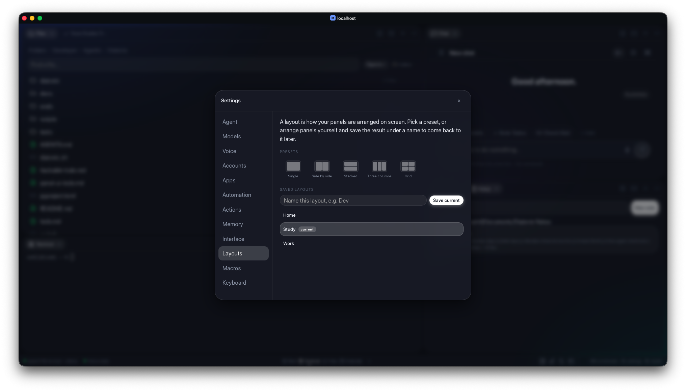

# Panels: the contract

An app panel is a JS module in `diatonic/web/apps/<id>.js` (or a panel the agent builds). The page loads it and calls:

```js
export async function render(el, ctx) { … }        // required: fill `el`
export async function navigate(params, ctx) { … }  // optional: move within the open panel (the agent uses it)
export const current = (ctx) => ({kind, ref, title})  // optional: what "this" means for "summarize this" (ctx is this panel's)
export const wide = true; export const width = 560; export const full = false; export const flush = false;
```

## `ctx`

| | |
|---|---|
| `api`, `h`, `esc`, `toast`, `reload()`, `prompt(text)` | as before: HTTP helper, element builder, escaping, toasts, re-render, fill the chat box |
| `id`, `app`, `params`, `el` | this panel instance, the app, what it was opened with, its container |
| `state.get(key, default)`, `state.set(key, value)` | data that survives reloads, kept per panel |
| `onResize((w, h) => …)` | called when the panel's size changes; returns an unsubscribe |
| `command({id, title, run, when?})` | add a command (palette, keys); removed when the panel closes |
| `list({items, open?})` | arrow keys, Home/End and Enter step through the panel's rows |
| `onClose(fn)` | run `fn` when the panel is replaced or closed: remove document-level listeners, clear timers |
| `store.get/set/keys/remove`, `store.add/addMany/update/updateMany/delete/query/tables` | the app's own data on the server: single values and tables of rows (`await ctx.store.addMany("topics", rows)`). Survives closing the panel and the browser, is deleted with the app, never reaches another app's data. No approval. Limits: 256 KB per value or row, 1000 rows per call, 20,000 rows per table |
| `fetch(url)` | read a web page or public API through the server: `const r = await ctx.fetch(url); r.json()` (also `status`, `ok`, `text`). GET only; text, HTML and JSON only (show images with an `img` tag); 2 MB and 15 seconds at most; never a local or private address (checked again after every redirect). The domain must be in the manifest's `permissions.fetch` and approved by the user, on every redirect too. A refusal throws an `Error` with a readable message: catch it and show it |
| `notify(title, body)` | tell the user something (inbox and a system banner). No card, but it must be declared (`permissions.notify`); 20 a minute at most |
| `timer.start(seconds, {label})`, `pause(id)`, `resume(id)`, `cancel(id)`, `list()`, `onDone(fn)` | countdowns that run on the server, so they keep going with the panel or the browser closed (and across a server restart). The user gets a notification when one ends and `onDone` fires if the panel is open. `list()` gives `{id, label, state, remaining}`, so a reopened panel shows the right time. Declare `permissions.timer`. 1 second to 7 days, 50 per app |
| `ui.*` | the UI kit: `ui.card`, `section`, `row`, `list`, `table`, `tabs`, `form`, `field`, `button`, `kv`, `stat`, `badge`, `empty`, `modal`, `chart`, plus `ui.listApp(spec)` (a whole list view) and `ui.run(label, fn, button?)` (see "The UI kit" below) |
| `on(event, fn)` | listen for `"timer:done"` (this app's timers), `"todo:changed"` or `"<app>:changed"` (that app's data changed). Removed when the panel closes. There is no mail event yet |
| `tool("gcal_list_events", args)` | run another app's tool; resolves to its result. Read tools just run. A tool that **changes** things must be in the manifest's `permissions.tools`, and **every call** shows the user an approval card naming the app (the same words as the chat card). The terminal and the interface tools are never available |

Everything registered through `ctx` is undone when the panel is replaced or closed.

## The rule that matters: no module-level state

Today only one panel is open at a time, so a module can keep its state in `let` variables. The workspace described in `todo.md` (Phase 2) opens several panels at once, two of the same app included, and that only works if each panel keeps its state on `ctx` (or inside `render`), not in the module. New panels should follow this now.

Audit: all clean (2026-11-16). Every built-in panel keeps its state per instance (on `ctx`, inside `render`, or in a WeakMap keyed by `ctx`). Checked by `node scripts/check_module_state.mjs` (0 lines found).

## Where a panel's content lives

A panel's content (its `el`) is **not** a child of the stack you see: it lives in a separate layer over the window and is only positioned on top of its stack's empty slot (`syncBodies` in `js/workspace.js`). That is deliberate. Re-attaching an element that contains an `<iframe>` reloads it, so a PDF in the Files panel went back to page 1 whenever the layout was re-rendered (a click, a new panel, a move). Because the content is never moved, a panel keeps its state, scroll position and any iframe through all of that. Consequences: do not rely on the content being inside `.workspace-stack` in CSS selectors, and a new layout preset still opens fresh panels (the old ones are closed), so it does reset them.

## Chat panels

There is one chat in the app. The chat panel shows the main chat (`#main`: streaming, approval cards, tool output, the home tiles). Opening, splitting or duplicating Chat while a chat panel is open focuses that panel instead of making a second one, and a saved layout with more than one chat keeps the first.

## Styling a panel

A panel body is wrapped in `.panel-body`, whose generic form rules (border, background, padding on every `input`/`textarea`, and `input + input { margin-top: 8px }`) reach everything inside it, including the main chat's composer. When a control inside a panel must look different, give your rule a `.panel-body` prefix or a higher specificity, then check the control's size in the browser. An icon next to a label goes in a span that holds only the icon: the app styles that span so the icon is centred on the text.

## Layouts


A **layout** is how the panels are arranged: the tree of splits and tabs and the app in each. There is one word and one way to keep one:



- **By mouse:** the layout button at the bottom right of the window opens the Layouts menu: presets as thumbnails, a name box to save the current layout, your saved layouts (click to switch, trash icon to delete, asked in place), undo, redo and reopen a closed tab. Settings → Layouts shows the same. Everything below also has a command.
- Arrange it with presets (`layout.preset.*`), splits, drag and drop, or the agent (`ui_arrange_panels`); `layout.undo` and `layout.redo` step through changes.
- **Save** the current arrangement under a name with `layout.save` (or ask the agent: "save this layout as Dev"). **Switch** with `layout.switch` or `/layout <name>` in the command bar, which lists the presets and your saved layouts together. To delete one, open the command bar and type `delete layout`: each saved layout has its own row, and you are asked to confirm. (`layout.delete` with no name opens that list.)
- Saved layouts live in `layouts.json` in the Diatonic home folder (`GET`/`PUT /api/layouts`). A `workspaces.json` from an earlier version is read until the next save.
- A **macro** is a different thing: a list of commands to run. Do not save a layout as a macro.

In the code, "workspace" only names the area of the window that shows the layout (`js/workspace.js`, `.workspace-*` classes).

## Mouse and keyboard: both, always

Every command should have a place to click, so nothing depends on knowing a key. The places are the status bar (Layouts, Scratchpad, command bar and Settings buttons on the right; a **+** after the pinned apps to pin or unpin any app), Settings (Layouts and Macros pages next to Keyboard), and the tab bar (split, add tab, and the **⋯ panel menu**: split, zoom, duplicate, move and swap towards a neighbour, pin, reload, open in its own window, close tab or close the others; right-click a tab for the same menu). Zoom only changes what is shown, never the saved layout. A command that needs a name, such as `layout.save` or `macro.record.start`, opens the page that has a name box and does not use a browser `prompt()`; a test checks the core commands for that. When you add a command, add its button or menu in the same change.


## The UI kit (`ctx.ui`)

Components in `web/js/ui/index.js` are plain functions: you give them props and get an element back, and everything is styled from the `:root` tokens, so light and dark both work. What each one takes is declared once in `web/js/ui/components.json` (docs, props, one example); the catalog (`platform_search "card"`), the **Components** panel (the gallery: every component with its live example) and the tests all read that file. To add a component, write the function, add its entry to the JSON, and the test in `tests/js/ui-kit.test.mjs` tells you what is missing.

- **`ui.listApp({rows, columns?, detail?, actions?, filters?, search?, marks?, empty?})`** builds a whole list view: search box, filter buttons, rows (a table when `columns` is given), check marks bound to `row[marks.key]`, a detail pane for the selected row, and the same `actions` on each row and in the detail. Arrow keys and Enter step through the rows (it registers `ctx.list` for you). It returns an element with `set(rows)` (show new data) and `selected()`. Every row needs a unique `id` and a `title`.
- **`ui.run(label, fn, button?)`** is how an action should run: the button is disabled meanwhile, a returned string is shown as the result, and a failure is shown to the user and written to the app's log (`read_app_logs`). `listApp` runs every action and mark through it.
- Examples that use all of this: `diatonic/recipes/timer`, `tracker` (on `ctx.store`) and `search` (on `ctx.fetch`). `scripts/render_recipes.mjs` installs each on a fresh scratch server, uses it and checks it in dark and light.
- Inside the test run before approval (`js/verify.js`) `ctx.ui` knows the component names only: a wrong name fails the run with the list of real ones.

## Apps the agent builds (file apps)

The agent builds an app as a folder in `~/.diatonic/apps/<id>/` (`manifest.json`, `index.js`, `style.css`, optional `tools.py`). It is a panel like any other: `index.js` exports `render(el, ctx)` with the `ctx` above and keeps no module-level state.

- **Building:** `create_file_app` makes an empty placeholder, `write_app_file` writes the whole `index.js`, `patch_app_file` changes one piece, `delete_file_app` removes the folder. An app is built only once `index.js` has been written; if a run asked for an app and none was written, the chat says it failed.
- **Checks:** the file rules and a test run of `index.js` in the sandboxed frame happen before the approval card, so the user is only asked about code that runs.
- **Permissions:** an app that uses notifications, timers, web domains or tools that change things lists them in `manifest.json`: `"permissions": {"notify": true, "timer": true, "fetch": ["youtube.com"], "tools": ["todos_add_todo"]}`. The user approves the whole list once (a card in the corner); the approved copy is kept in the user's settings, not in the app's folder, so the agent cannot grant itself anything. If the manifest later asks for more, the card shows again with the new items marked. Using something that was not declared fails with a message that says what to add. `ctx.store`, `ctx.state` and read tools need no declaration.
- **Edits show up:** the module URL carries the manifest version, so a panel opened after an edit loads the new code.
- **Deleting:** closes the app's tabs and removes its settings (switch, rail slot, status bar pin, home tile).
- **`tools.py`:** code the agent wrote. Its tools always ask for approval and a panel cannot call them.
- **Things that keep records** (trackers, logs, habits) are built as file apps like everything else. They keep data in `ctx.store` (on the server). `ctx.state` is for view settings only: it lives in the browser.

## For the agent

- Start from a recipe (`ui_read_skill("recipes")`): timer, tracker or search. Copy it, give it a new id, and change only what the request needs.
- `export async function render(el, ctx)`. No module-level variables, no imports, no `fetch` or `localStorage`. Always `await` `ctx` calls.
- Build with `ctx.ui` components and the tokens (`var(--accent)`); never write colours.
- Save records with `ctx.store`, reach the web with `ctx.fetch`, run countdowns with `ctx.timer`. Put many rows in one call (`addMany`).
- Declare what the app uses in `manifest.json` `permissions`.
- To change an app, `ui_read_app_file`, then `ui_patch_app_file` with the exact old text. When something fails, `ui_read_app_logs` and fix only what it names.
